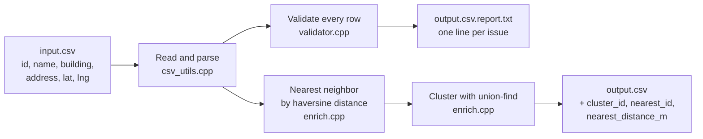

# liftspot-data-tool

A small C++ command-line tool that checks the building data behind [LiftSpot](https://github.com/selinmutlu06/liftspot), my map of elevators across Long Island, Queens, and Brooklyn ([live here](https://liftspot.netlify.app)). It reads a CSV of buildings, flags anything that looks wrong, and adds two things the map uses, which are each building's nearest neighbor and which buildings sit close enough together to count as a cluster.

## What it does



Every row goes through these checks, and each problem gets its own line in the report.

| Check | What it catches |
|-------|-----------------|
| `missing_id` / `duplicate_id` | A row with no id, or an id that already appeared |
| `missing_coords` | Latitude or longitude that's empty or isn't a number |
| `invalid_coords` | Latitude outside ±90 or longitude outside ±180 |
| `duplicate_coords` | Two rows pinned to the same spot, to about a meter |
| `missing_address` / `malformed_address` | An empty address, or one too short to be real |
| `missing_building` | A row with no building name |

## Example

The repo includes a small test file with problems planted on purpose, using buildings on Duke's campus.

```bash
./liftspot_data_tool data/sample_elevators.csv out.csv
```

```
Loaded 8 elevator records from data/sample_elevators.csv
Found 7 validation issue(s)
Wrote validation report to out.csv.report.txt
Wrote cleaned + enriched data to out.csv
```

```
[missing_address] id=e4 -- address field is empty
[duplicate_coords] id=e6 -- same coordinates as e1
[duplicate_id] id=e2 -- id already seen
[invalid_coords] id=e2 -- lat/lng out of valid range
[malformed_address] id=e2 -- address looks too short to be real
[missing_coords] id=e7 -- lat/lng missing or unparseable
[missing_address] id=e7 -- address field is empty
```

Running it on 100 real LiftSpot buildings (`data/liftspot_real.csv`) found no issues and grouped them into 93 clusters, where 7 pairs of buildings sit within 100 meters of each other.

## How it works

Nearest neighbor uses the haversine formula, which measures distance along the curve of the Earth instead of treating latitude and longitude as flat x and y. Every building is compared against every other building, and the closest one gets written to the row along with its distance in meters.

Clustering uses union-find. Any two buildings within the threshold (100 meters by default) get joined into the same group, and because joining is transitive, a chain of buildings that are each close to the next all end up in one cluster even if the two ends are far apart. The `find` step uses path compression, so lookups stay fast as groups grow. Buildings without coordinates are labeled `unclustered_no_coords` instead of being guessed at.

## Why I built it this way

I wrote it in C++ mostly because I wanted to implement union-find and haversine myself, with nothing but the standard library, instead of calling a geospatial package that hides how they work. It also kept the tool fast and dependency-free, so it builds anywhere with one command.

I kept validation and enrichment as separate steps with separate outputs. The report is for me to read and fix, and the CSV is what the app uses, so a bad row never silently disappears. It shows up in the report and I decide what to do about it.

## Limitations

- Comparing every building against every other one is O(n²). That takes no time at a few hundred buildings, but at tens of thousands I'd switch to a spatial index like a grid or k-d tree so each building only checks its neighbors.
- Flagged rows are reported but not removed, and right now a row with out-of-range coordinates still gets a nearest neighbor and a cluster. Skipping those rows during enrichment is the next fix.
- The CSV parser handles quoted fields with commas, but not escaped quotes inside a field.

## Build

With CMake:

```bash
cmake -B build && cmake --build build
./build/liftspot_data_tool <input.csv> <output.csv> [cluster_threshold_meters]
```

Or directly with g++:

```bash
g++ -std=c++17 -O2 -o liftspot_data_tool src/*.cpp
./liftspot_data_tool <input.csv> <output.csv> [cluster_threshold_meters]
```

The input needs a header row of `id,name,building,address,lat,lng`. The cluster threshold is optional and defaults to 100 meters.

## Project structure

```
src/
  main.cpp          reads arguments, runs each step, writes the report
  csv_utils.cpp     CSV reading and writing
  validator.cpp     the row checks
  geo_utils.cpp     haversine distance
  enrich.cpp        nearest neighbor and union-find clustering
  elevator.h        one row of data
data/
  sample_elevators.csv    test file with planted problems
  liftspot_real.csv       100 real LiftSpot buildings
  liftspot_cleaned.csv    the tool's output on that file
```
